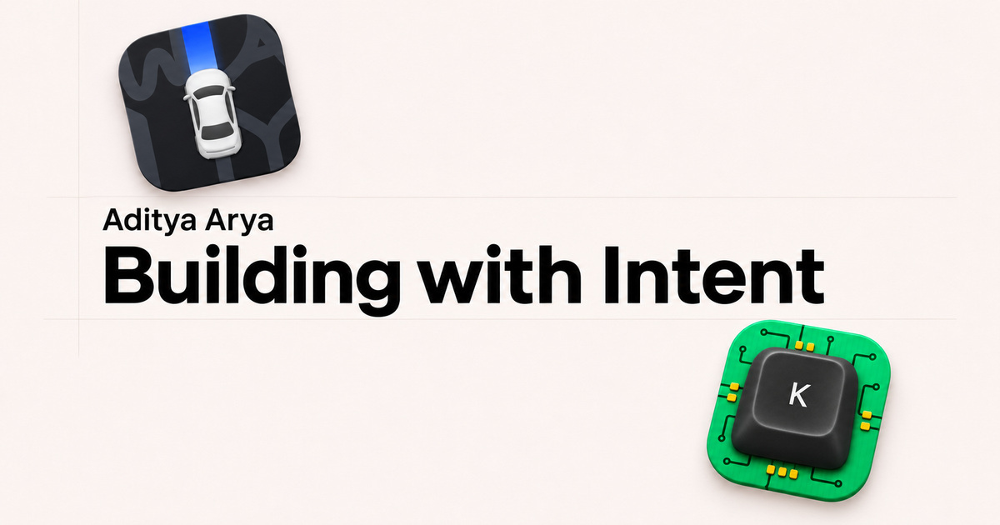
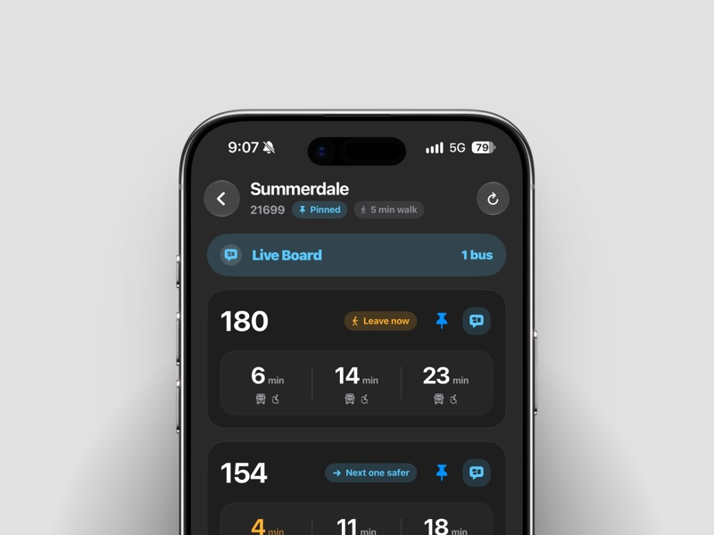
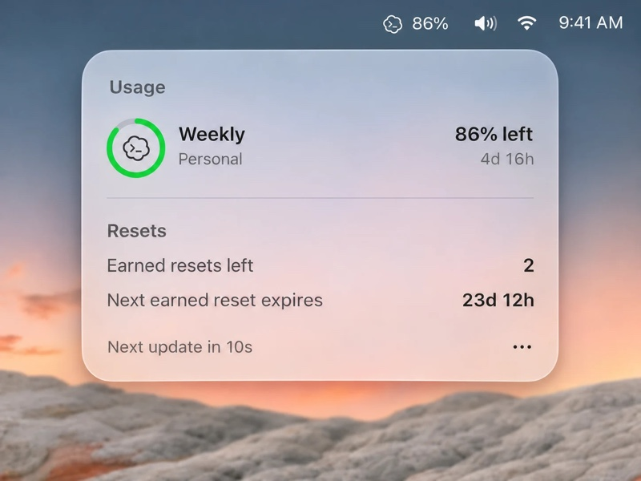
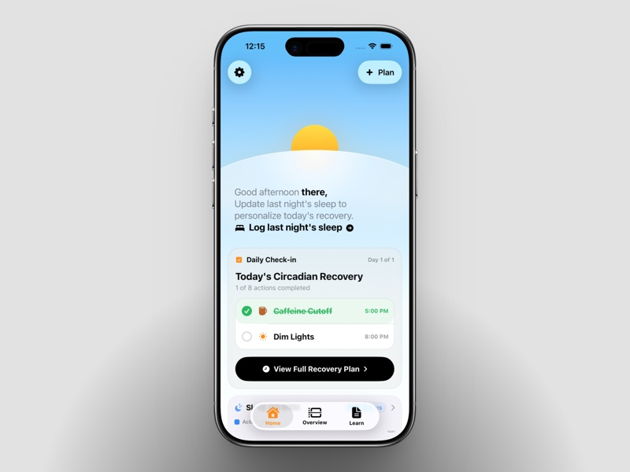

<table width="100%">
  <tr>
    <td width="50%"><strong>Hey, I’m Aditya Arya.</strong></td>
    <td width="50%" align="right"><a href="https://www.linkedin.com/in/aditya-arya1/">LinkedIn</a> · <a href="https://x.com/adiarya05">X</a> · <a href="https://cal.com/aditya-arya/design">Book a call</a></td>
  </tr>
  <tr>
    <td colspan="2">
       
      <a href="https://adiarya.com/"><strong>Portfolio ↗</strong></a> · I design and build apps for iPhone and Mac in Singapore.
    </td>
  </tr>
  <tr>
    <td width="50%">
       
      <a href="https://github.com/AdiArya05/Catch"><strong>Catch SG Buses</strong></a>
    </td>
    <td width="50%">
       
      <a href="https://github.com/AdiArya05/codex-usage-menu-bar"><strong>Codex Usage</strong></a>
    </td>
  </tr>
  <tr>
    <td width="50%">
       
      <a href="https://adiarya.com/work/wayauto"><strong>WayAuto icon</strong></a>
    </td>
    <td width="50%">
       
      <a href="https://adiarya.com/work/soja"><strong>Soja</strong></a>
    </td>
  </tr>
  <tr>
    <td colspan="2">
      <strong>Apple</strong> 
      
      
      
      
      
      
    </td>
  </tr>
  <tr>
    <td colspan="2">
      <strong>Web &amp; data</strong> 
      
      
      
      
      
    </td>
  </tr>
</table>
