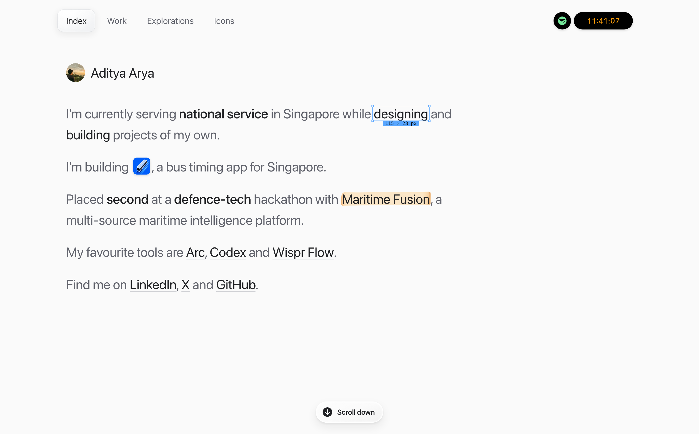
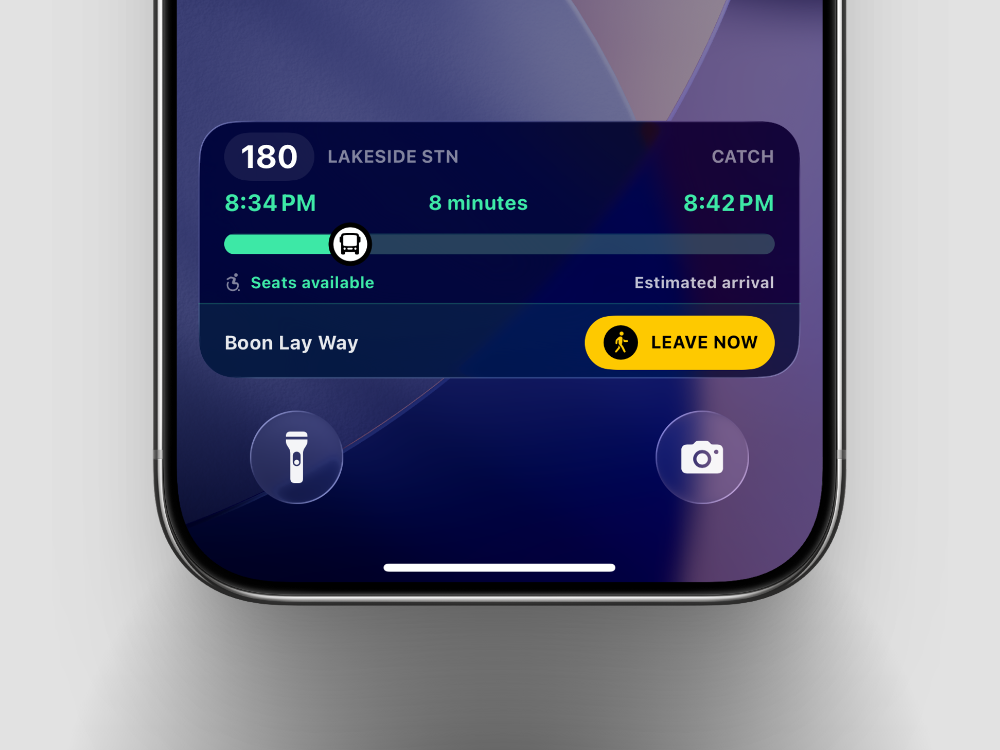
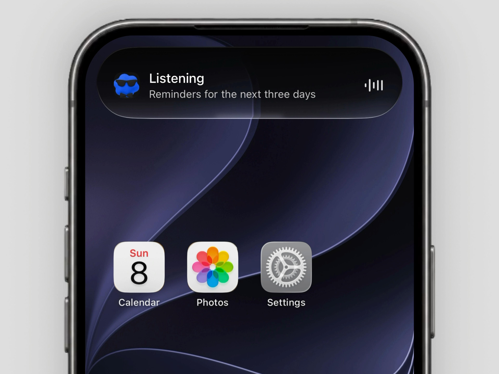

<table width="100%">
  <tr>
    <td width="72%"><strong>Hey, I’m Aditya Arya.</strong> · Building with intent</td>
    <td width="28%" align="right"><a href="https://www.linkedin.com/in/aditya-arya1/">LinkedIn</a> · <a href="https://x.com/adiarya05">X</a> · <a href="https://cal.com/aditya-arya/design">Book a call</a></td>
  </tr>
  <tr>
    <td rowspan="2" width="72%">
       
      <a href="https://adiarya.com/"><strong>Portfolio ↗</strong></a>
    </td>
    <td width="28%">
       
      <a href="https://github.com/AdiArya05/Catch"><strong>Catch SG Buses</strong></a>
    </td>
  </tr>
  <tr>
    <td width="28%">
       
      <a href="https://github.com/AdiArya05/dot-prototype"><strong>Dot in the Dynamic Island</strong></a>
    </td>
  </tr>
  <tr>
    <td colspan="2">
      <strong>Apple</strong> &nbsp;
      
      
      
      
      
      
    </td>
  </tr>
  <tr>
    <td colspan="2">
      <strong>Web &amp; data</strong> &nbsp;
      
      
      
      
      
    </td>
  </tr>
</table>
